<div align="center">

# ✻ Spark HUD

**See your context window, your Max plan limits and every agent at a glance, right above the Claude Code prompt.**

[](https://github.com/Mel0nidas/spark-hud)
[](https://github.com/Mel0nidas/spark-hud/releases)
[](LICENSE)
[](#install)



</div>

---

Claude Code tells you a lot, but only when you ask: `/context` for the window, `/cost` for the bill, a warning when you are already close to the limit. **Spark HUD keeps all of it on screen, live**, on a single line in the status line under the prompt that stays out of your way. `/hud` opens it into the card above the prompt, and from there into a full dashboard.

It is built for people who run long sessions on a **Max subscription** and work with **many agents and windows at once**.

## Why you'll want it

| Without Spark HUD | With Spark HUD |
|---|---|
| You find out the context is full when autocompact kicks in | A live bar shows how full the context is, and where autocompact will trigger |
| "Am I going to hit my 5-hour limit?" is a guess | A **pace forecast** compares your usage with the time left and warns you *before* the window runs out |
| Subagents are a black box until they report back | Each agent's **current action** shows live, and one click opens its full transcript |
| Checking your other Claude windows means alt-tabbing through them | **Every open Claude Code window** shows its project, model, context fill and current action in one list |

## Features

### 📊 Context window, live
- Fill bar with 1/8-cell precision, tokens used / window size, and the autocompact threshold.
- A breakdown of what fills the window (messages, system tools, MCP tools, memory files) when expanded.
- A toast when you pass 85%, a good moment to `/compact`.

### ⏳ Max plan limits, with pace forecasting
- **5-hour** and **7-day** windows with their reset countdowns.
- **Pace forecast**: compares the share of the limit you've used with the share of time that has passed, and tells you whether you're *comfortable*, *ahead of pace*, or *on track to run out before the reset* (and when).
- Toasts at 75% and at 90%.

### 🤖 Agents, without opening their transcripts
- Every subagent and teammate in the session, with a spinner, its type, its task and **its latest tool call**.
- Tool count and running time for each one; finished agents get ✔, failed ones get ✘.

### 🔍 Agent viewer: see inside any subagent
- **Click an agent** in the HUD (or run `/hud-agents`) and a panel opens with its **live transcript**: the task it got, what it is saying, and every tool call with a one-line result (errors in red).
- Shows the agent's **own context usage**, its model, tool count and running time.
- Flip between agents with `◀ ▶` and close it with `Esc`. It updates every second while the agent runs, and you never leave your current window.



### 🪟 All your windows in one place
- Every Claude Code session running Spark HUD sends a small heartbeat. Each window then lists the others: project, model, context %, running agents and what each one is doing **right now**.
- `/hud-panel` opens a side panel with the full list, which works well in fullscreen.

### 💡 Session stats and tips
- API-equivalent cost, tool calls, last turn duration, **cache hit rate** and output tokens.
- Tips based on your numbers: compact soon, switch to Sonnet for simple work, protect your prompt cache, watch out with too many parallel agents.

### ✨ It's alive (but calm)
- **Claude's mascot** lives on the right side of the HUD, away from your numbers. It **blinks** at rest, **dances** while Claude works, **celebrates** when a turn ends and **sweats** when the context is nearly full. It wears the colors of your theme.
- Animated gradient rules frame the widget so it never blends into the transcript.
- A soft glint runs along the bars while a turn is in progress.



## Themes

Seven calm palettes: a dark neutral plus one accent color, starting with **Claude** orange. The theme **only changes when you ask**: press `🎨 theme` or run `/hud-theme` to switch to the next one, and your pick is remembered for new sessions.



## Install

In Claude Code, run:

```
/plugin install spark-hud --marketplace Mel0nidas/spark-hud
```

Answer `y` to add the marketplace and pick the **user** scope. The HUD appears right away and in every new session. There is nothing to configure.

<details>
<summary>Install from a local clone</summary>

```bash
git clone https://github.com/Mel0nidas/spark-hud.git
claude plugin marketplace add ./spark-hud
claude plugin install spark-hud@agus-mods --scope user
```

Claude Code reads a folder marketplace straight from disk. After you edit the files, run `/reload-plugins`.
</details>

## Usage

| Command / control | What it does |
|---|---|
| `/hud` | Cycle one line (the default) → card → full dashboard |
| `▾ more` / `▴ less` | Expand or collapse the dashboard |
| `▿ line` | Back to the one line in the status line |
| Click an agent or `/hud-agents` | Open the agent viewer with its live transcript (`◀ ▶` switch, `Esc` closes) |
| `◫ panel` or `/hud-panel` | Open the side panel with all agents and windows |
| `🎨 theme` or `/hud-theme` | Switch to the next color theme |
| `ctrl+x tab` | Focus the HUD to use its buttons from the keyboard |

The layout adapts to the terminal width. On narrow terminals the bars get shorter and the secondary figures are hidden.

## Status line

The default one-line HUD is drawn in Claude Code's status line, which only your `statusLine` setting can fill. Point it at the script in this repository (it replaces any other status line) in `~/.claude/settings.json`:

```json
"statusLine": {
  "type": "command",
  "command": "node /path/to/spark-hud/scripts/statusline.mjs",
  "refreshInterval": 1
}
```

`refreshInterval` keeps spinners and the current action live while the session is idle. Until the mod has written its line, the script prints context and limits from the status line's own input.

## How it works

Spark HUD is a **Claude Code mod**: a single TypeScript hooks module that runs inside Claude Code's plugin sandbox. It has no Node, no network access and no background process of its own.

| Data | Source |
|---|---|
| Context, limits, cost | `$.session.usage()` and the `session.measure` event: the same figures as the status line, pushed when they change |
| Context breakdown | `$.session.usage({ breakdown: 'summary' })`, a local estimate that makes no API calls |
| Agents | `$.agent.list()` plus each `tool.call` that carries an `agentId` |
| Agent viewer | `$.session.messages({ agentId })` (the subagent's own transcript) and each `turn.step`'s usage for its context |
| Other windows | A small JSON heartbeat per session in `~/.claude/spark-hud/sessions/`, written every ~5 s |
| Animation | One timer: ~4.5 fps while Claude works, ~1 fps at rest |

**Privacy:** everything stays on your machine. The only file Spark HUD writes is its heartbeat (project folder name, model, context %, last action), and it never sends data anywhere.

## Requirements

- Claude Code **2.1.295** or newer (function-hook mods).
- Rate-limit bars appear on Claude subscriptions (Pro / Max) after the first response; API-key users still get context, cost, agents and windows.

## Development

```bash
claude plugin validate .   # manifest + hooks module, as the engine reads them
claude plugin test .       # runs tests/*.test.tsx against the engine
```

To hot-reload while you edit, run `claude --plugin-dir ./spark-hud`. Saving a file reloads the mod.

## Roadmap

- [ ] Sparkline of context growth per turn
- [ ] Click a window in the list to bring it to the front

Ideas and PRs are welcome. Open an issue!

## License

[MIT](LICENSE) © agusneocube

<div align="center"><sub>Made with ✻ and Claude Code.</sub></div>
