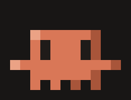

<div align="center">

# ✻ Spark HUD

**See your context window, your plan limits and every agent at a glance, right above the Claude Code prompt.**

[](https://github.com/Mel0nidas/spark-hud)
[](https://github.com/Mel0nidas/spark-hud/releases)
[](LICENSE)
[](#privacy-and-security)


</div>

---

Claude Code tells you a lot, but only when you ask: `/context` for the window, `/cost` for the bill, a warning when you are already close to the limit. **Spark HUD keeps all of it on screen, live**, in two compact lines that stay out of your way. Click one button and it opens into a full dashboard.

It is built for people who run long sessions on a **Pro or Max subscription** and work with **many agents and windows at once**. It works on macOS, Linux and Windows, in any terminal Claude Code supports.

## Why you'll want it

| Without Spark HUD | With Spark HUD |
|---|---|
| You find out the context is full when autocompact kicks in | A live bar shows how full the context is, and where autocompact will trigger |
| "Am I going to hit my 5-hour limit?" is a guess | A **pace forecast** compares your usage with the time left and warns you *before* the window runs out |
| Subagents are a black box until they report back | Each agent's **current action** shows live, and one click opens its full transcript |
| Checking your other Claude windows means alt-tabbing through them | **Every open Claude Code window** shows its project, model, context fill and whether it is busy, in one list |

## Features

### 📊 Context window, live
- Fill bar with 1/8-cell precision, tokens used / window size, and the autocompact threshold.
- A breakdown of what fills the window (messages, system tools, MCP tools, memory files) when expanded.
- One toast when you pass 85%, a good moment to `/compact`.

### ⏳ Plan limits, with pace forecasting
- **5-hour** and **7-day** windows with their reset countdowns.
- **Pace forecast**: compares the share of the limit you've used with the share of time that has passed, and tells you whether you're *comfortable*, *ahead of pace*, or *on track to run out before the reset* (and when).
- One toast when you cross 75% and one at 90% (no repeats).

### 🤖 Agents, without opening their transcripts
- Every subagent and teammate in the session, with a spinner, its type, its task and **its latest tool call**.
- Tool count and running time for each one; finished agents get ✔, failed ones get ✘.

### 🔍 Agent viewer: see inside any subagent
- **Click an agent** in the HUD (or run `/hud-agents`) and a panel opens with its **live transcript**: the task it got, what it is saying, and every tool call with a one-line result (errors in red).
- Shows the agent's **own context usage**, its model, tool count and running time.
- Flip between agents with `◀ ▶` and close it with `Esc`. It updates every second while the agent runs, and stops reading the transcript as soon as you close it.


### 🪟 All your windows in one place
- Every Claude Code session running Spark HUD writes a tiny status file. Each window then lists the others: project folder, model, context %, running agents and whether it is busy (with the bare tool name, like `Bash` or `Read`). [What is shared, exactly](#privacy-and-security).
- `/hud-panel` opens a side panel with the full list, which works well in fullscreen.

### 💡 Session stats and tips
- API-equivalent cost, tool calls, last turn duration, **cache hit rate** and output tokens.
- Tips based on your numbers: compact soon, switch to Sonnet for simple work, protect your prompt cache, watch out with too many parallel agents.

### ✨ It's alive (but calm)
- **A DONE sign** when Claude finishes: a green `✔ DONE` pill says the prompt is ready for the next task (or how many background agents are still running). It stays until you send your next prompt; the thumbs-up animation plays once and leaves by itself.
- **Claude's mascot in pixel art** lives on the right side of the HUD, drawn with half-block pixels in your theme's colors, and **every change of state is animated**: it glances around at rest, crouches and hops when you send a prompt, dances (with notes) while Claude works, and when a turn ends it jumps, bursts into sparks, a thumbs-up rises, catches a glint and sinks away, and the mascot pops back up. An interrupted turn makes it shake its head; a nearly full context makes it sweat.
- Animated gradient rules frame the widget so it never blends into the transcript.
- A soft glint runs along the bars while a turn is in progress.

<p align="center"></p>


## Themes

Seven calm palettes: a dark neutral plus one accent color, starting with **Claude** orange. The theme **only changes when you ask**: press `◐ theme` or run `/hud-theme` to switch to the next one, and your pick is remembered for new sessions.


## Install

In Claude Code, run:

```
/plugin install spark-hud --marketplace Mel0nidas/spark-hud
```

Answer `y` to add the marketplace and pick the **user** scope. The HUD appears right away and in every new session. The defaults work as they are; see [Settings](#settings) to change them.

<details>
<summary>Install from a local clone</summary>

```bash
git clone https://github.com/Mel0nidas/spark-hud.git
claude plugin marketplace add ./spark-hud
claude plugin install spark-hud@agus-mods --scope user
```

Claude Code reads a folder marketplace straight from disk. After you edit the files, run `/reload-plugins`.
</details>

## Usage

| Command / control | What it does |
|---|---|
| `▾ more` / `▴ less` or `/hud` | Expand or collapse the dashboard |
| Click an agent or `/hud-agents` | Open the agent viewer with its live transcript (`◀ ▶` switch, `Esc` closes) |
| `◫ panel` or `/hud-panel` | Open the side panel with all agents and windows |
| `◐ theme` or `/hud-theme` | Switch to the next color theme |
| `ctrl+x tab` | Focus the HUD to use its buttons from the keyboard |

The layout adapts to the terminal width and height. On narrow terminals the bars get shorter and the secondary figures are hidden; when Claude Code's own agent list below the prompt takes rows from the band, the HUD drops its frame and then its gauges instead of being squashed.

## Settings

Change them in `/config` (each one is a row there), or in `~/.claude/settings.json` under `pluginConfigs`, keyed by the plugin and its marketplace (`spark-hud@agus-mods` when installed as above):

| Setting | Default | What it does |
|---|---|---|
| `animation` | `full` | `full`: smooth motion while Claude works, one redraw a second at rest. `calm`: slower motion. `off`: no motion at all, and a redraw every 15 s at rest |
| `shareWithOtherWindows` | `true` | `false`: no status file is written or read, and the *Other windows* list stays empty |

```json
{
  "pluginConfigs": {
    "spark-hud@agus-mods": { "options": { "animation": "calm", "shareWithOtherWindows": false } }
  }
}
```

## How it works

Spark HUD is a **Claude Code mod**: a single TypeScript hooks module that runs inside Claude Code's plugin sandbox. It has no Node, no network access and no background process of its own.

| Data | Source |
|---|---|
| Context, limits, cost | `$.session.usage()` and the `session.measure` event: the same figures as the status line, pushed when they change |
| Context breakdown | `$.session.usage({ breakdown: 'summary' })`, a local estimate that makes no API calls |
| Agents | `$.agent.list()` plus each `tool.call` that carries an `agentId` |
| Agent viewer | `$.session.messages({ agentId })` (the subagent's own transcript) and each `turn.step`'s usage for its context |
| Other windows | One small status file per window in `~/.claude/spark-hud/sessions/` (or `$CLAUDE_CONFIG_DIR/spark-hud/sessions/`), rewritten only when it changes |
| Animation | One timer that slows down by itself: ~4.5 redraws/s while Claude works, 1/s at rest (`animation: off` makes that one every 15 s) |

## Privacy and security

Spark HUD never sends anything anywhere: it makes no network calls at all. What it touches on your machine:

**What it writes to disk** (only with `shareWithOtherWindows` on, the default): one file per open window, holding exactly this and nothing else:

```json
{"id":"<session id>","project":"my-app","model":"claude-opus-5-5","ctxPercent":42,"working":true,"activity":"Bash","agentsRunning":1,"updatedAt":1761571200000}
```

- **Never** a command, a file path, a URL, a search term, a prompt, a message or a tool's output. `activity` is the bare tool name, and every MCP tool is just `MCP`, so not even the server name leaks.
- **No pile-up.** Claude Code gives mods no way to delete files, so a new window takes over the file of a window that has closed or gone silent instead of adding one. The folder holds about as many files as you ever had windows open at once, and you can delete it any time: the next session creates it again.
- **Old files are scrubbed.** Version 0.4 and earlier wrote the first 48 characters of the last tool call (so the start of a Bash command could land on disk). On start, 0.5 overwrites every stale file in the folder with `{"ended":true}`.

**What it reads:**

- The other windows' status files. These are treated as untrusted: anything that is not a plain, bounded value is dropped, numbers are clamped, text is cut short and stripped of control characters and bidi overrides (so a planted file cannot inject terminal escape codes), files over 4 KB are skipped, and at most 8 windows are listed.
- A subagent's transcript, **only while you have its viewer open**, to draw it on your screen. Closing the viewer stops the reads. Nothing from it is stored or written anywhere.
- The usage figures Claude Code already shows in `/context` and `/cost`.

**What it hooks:** every tool call, to count tools and show the current action in your own HUD. The hook only reads the call's name and input for that one line on screen; it never blocks, changes or delays a call.

Found a problem? Please [open an issue](https://github.com/Mel0nidas/spark-hud/issues).

## Requirements

- Claude Code **2.1.295** or newer (function-hook mods).
- Rate-limit bars appear on Claude subscriptions (Pro / Max) after the first response; API-key users still get context, cost, agents and windows.
- A terminal font with block and Braille characters (any modern one: Windows Terminal, iTerm2, GNOME Terminal, Kitty, WezTerm, VS Code).

## Development

```bash
claude plugin validate .   # manifest + hooks module, as the engine reads them
claude plugin test .       # runs tests/*.test.ts against the engine
```

`tests/gallery.test.ts` lays every view out as text, in every state that matters (fresh, API key, all limits red, a dozen agents, hostile peer files, CJK and emoji text) at widths from 32 to 220 columns, and fails when a line overflows, a row wraps or the band runs past its rows. Set `SHOW = true` in `tests/render.ts` to print the previews.

To hot-reload while you edit, run `claude --plugin-dir ./spark-hud`. Saving a file reloads the mod.

## Roadmap

- [ ] Sparkline of context growth per turn
- [ ] Click a window in the list to bring it to the front

Ideas and PRs are welcome. Open an issue!

## License

[MIT](LICENSE) © agusneocube

<div align="center"><sub>Made with ✻ and Claude Code.</sub></div>
